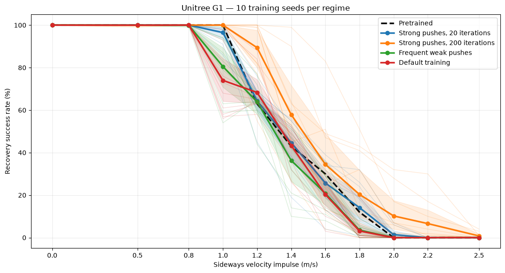

# Unitree G1 — Disturbance Recovery

A small experiment with reinforcement learning in Isaac Lab.

I took a pretrained Unitree G1 walking policy and fine-tuned it using PPO to see whether it could learn to recover from stronger sideways pushes.

## Demo

<table>
  <tr>
    <th>Original policy</th>
    <th>Fine-tuned policy</th>
  </tr>
  <tr>
    <td><video src="https://github.com/user-attachments/assets/881fc4f9-423b-48b4-a6fb-f841389f0fa6" controls width="320"></video></td>
    <td><video src="https://github.com/user-attachments/assets/ba2c0dad-4ce0-4eb5-8298-ad4691f7d1e6" controls width="320"></video></td>
  </tr>
</table>

Both robots receive the same sideways velocity perturbation while walking.

## Results

I compared three training setups: stronger sideways pushes, weaker frequent pushes, and the default Isaac Lab configuration.

Each policy was trained for 200 PPO iterations, with 10 runs per setup. I then tested how often the robot stayed upright after different pushes.

Training with stronger disturbances generally helped with larger pushes, although the results varied quite a bit between runs.

## Code

The [Colab notebook](G1_Disturbance_Recovery.ipynb) contains the training, evaluation, and video recording code.

Built with Isaac Lab 3.0, RSL-RL (PPO), and Newton/MuJoCo Warp. Experiments were run on a Google Colab T4 GPU.
